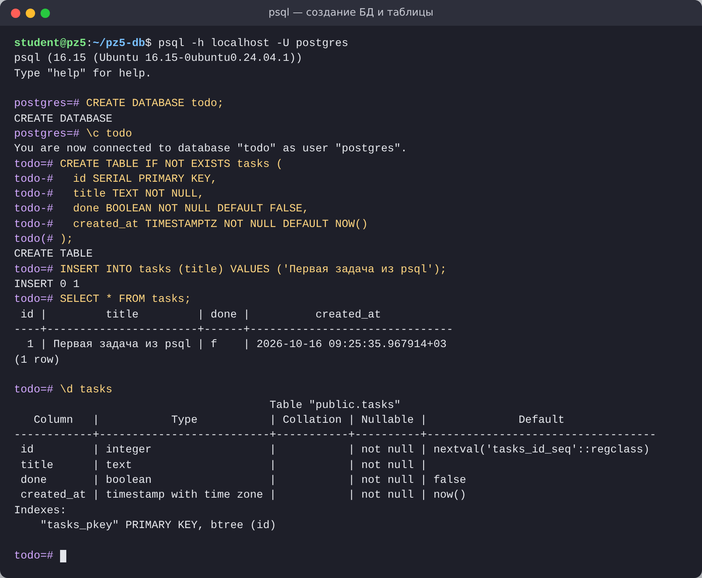
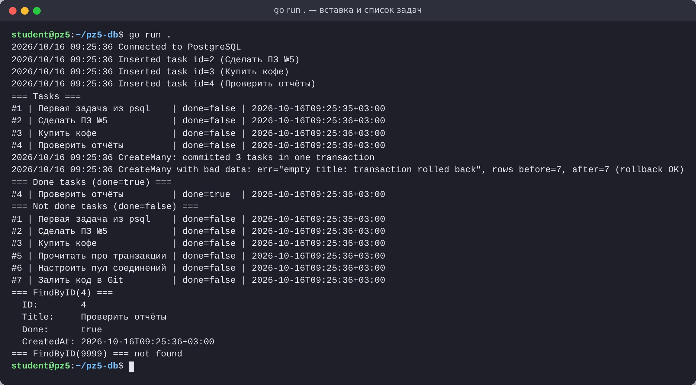
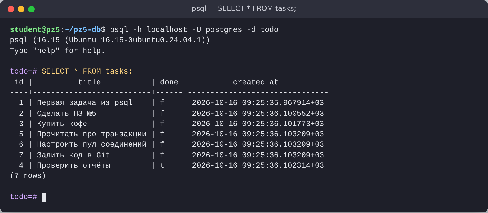
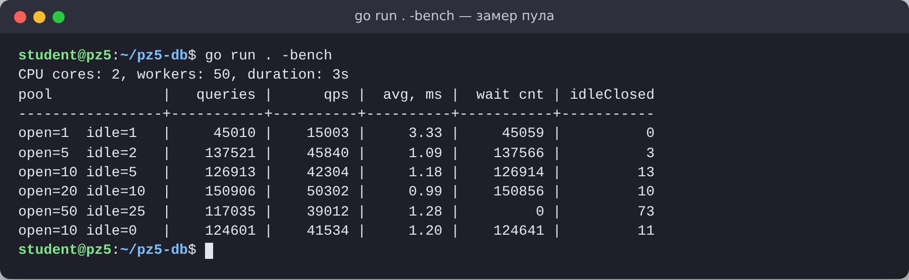

# ПЗ №5. Подключение к PostgreSQL через database/sql. Выполнение простых запросов (INSERT, SELECT)

| | |
|---|---|
| **Дисциплина** | Технологии индустриального программирования |
| **Студент** | Абдулатифзода Акмал |
| **Группа** | ____________ |
| **Дата** | 16.10.2026 |
| **Преподаватель** | Адышкин С. С. |

## Окружение

| Компонент | Версия |
|---|---|
| ОС | Ubuntu 24.04.5 LTS (ядро Linux 6.18), 2 ядра CPU, 8 ГБ ОЗУ |
| Go | go1.24.7 linux/amd64 |
| PostgreSQL | 16.15 (psql 16.15) |
| Драйвер | github.com/jackc/pgx/v5 v5.7.6 (через `pgx/v5/stdlib`, режим совместимости с `database/sql`) |
| .env | github.com/joho/godotenv v1.5.1 |

## Структура проекта

```
pz5-db/
├── main.go          # запуск: DSN → INSERT → SELECT + проверочные задания
├── db.go            # подключение к БД и настройка пула
├── repository.go    # репозиторий: CreateTask, ListTasks, ListDone, FindByID, CreateMany
├── bench.go         # задание 4: замер пула (go run . -bench)
├── sql/init.sql     # создание БД и таблицы
├── screenshots/     # скриншоты для отчёта
├── .env.example     # пример строки подключения
├── go.mod / go.sum
```

## Запуск

```bash
# 1. Создать БД и таблицу
psql -U postgres -f sql/init.sql

# 2. Указать строку подключения
cp .env.example .env      # и заменить YOUR_PASSWORD

# 3. Запустить
go run .                  # вставка, список, проверочные задания 1–3
go run . -bench           # задание 4: замер пула соединений
```

## Скриншоты

**Создание БД и таблицы в psql**



**Успешный вывод `go run .` (вставка, список задач, задания 1–3)**



**`SELECT * FROM tasks;` в psql** — те же записи, что вывела программа. Задача №4 стоит в конце, потому что после `UPDATE` PostgreSQL записал новую версию строки в конец таблицы (MVCC); без `ORDER BY` порядок строк не гарантирован, поэтому в коде везде стоит `ORDER BY id`.



**Замер настроек пула (`go run . -bench`)**



## Проверочные задания

1. **`ListDone(ctx, done bool)`** — `SELECT ... WHERE done = $1 ORDER BY id`.
2. **`FindByID(ctx, id int) (*Task, error)`** — `QueryRowContext` + `Scan`; `sql.ErrNoRows` превращается в собственную ошибку `ErrNotFound`. В `main` выводятся подробности задачи и пример ненайденного id.
3. **`CreateMany(ctx, titles []string) error`** — `BeginTx` → подготовленный `INSERT` → `Commit`; при любой ошибке `Rollback`. В `main` показан и успешный коммит, и откат (пустой заголовок → в таблице столько же строк, сколько было).
4. **Настройки пула** — замер ниже.

### Замер пула (2 ядра, 50 горутин, 3 с, короткий `SELECT` по id)

| Пул | Запросов/с | Средн. задержка, мс | Ожиданий свободного соединения |
|---|---:|---:|---:|
| open=1, idle=1 | 15 003 | 3,33 | 45 059 |
| open=5, idle=2 | 45 840 | 1,09 | 137 566 |
| **open=10, idle=5** | **42 304** | **1,18** | 126 914 |
| open=20, idle=10 | 50 302 | 0,99 | 150 856 |
| open=50, idle=25 | 39 012 | 1,28 | 0 |
| open=10, idle=0 | 41 534 | 1,20 | 124 641 |

**Вывод и выбор:** `SetMaxOpenConns(10)`, `SetMaxIdleConns(5)`, `SetConnMaxLifetime(30m)`, `SetConnMaxIdleTime(5m)`.

* Одно соединение — узкое место: все горутины стоят в очереди, пропускная способность в 3 раза ниже.
* От 5 до 20 соединений результат примерно одинаковый (разница в пределах разброса между запусками): на 2 ядрах сервер PostgreSQL больше параллельной работы не выполнит.
* 50 соединений работают **хуже**: ожиданий нет, но сервер тратит ресурсы на переключение между процессами, а лишние соединения постоянно закрываются (`idleClosed = 73`).
* 10 открытых — с запасом для пиков и далеко от лимита сервера (`max_connections = 100`), 5 простаивающих — чтобы не открывать соединение заново на каждый запрос (с `idle=0` каждое соединение после запроса закрывается).
* `ConnMaxLifetime = 30 мин` — периодически пересоздаёт соединения (после перезапуска БД, смены сети, балансировщика), `ConnMaxIdleTime = 5 мин` — освобождает лишние соединения в простое.

## Краткие ответы

**Что такое пул соединений `*sql.DB` и зачем его настраивать?**
`*sql.DB` — не одно соединение, а потокобезопасный пул: он сам открывает соединения, раздаёт их запросам и возвращает обратно. Открывать TCP-соединение и проходить аутентификацию на каждый запрос дорого, поэтому соединения переиспользуются. Настройка нужна, чтобы ограничить нагрузку на сервер (у PostgreSQL каждое соединение — отдельный процесс, а `max_connections` ограничен), держать «тёплые» соединения для быстрых ответов и вовремя закрывать старые и лишние.

**Почему используем плейсхолдеры `$1`, `$2`?**
Значения передаются в БД отдельно от текста запроса, поэтому они никогда не интерпретируются как SQL — это защита от SQL-инъекций. Кроме того, драйвер сам приводит типы Go к типам PostgreSQL, а сервер может переиспользовать план подготовленного запроса.

**Чем отличаются `Query`, `QueryRow` и `Exec`?**
* `Exec` — запрос без возврата строк (`INSERT`/`UPDATE`/`DELETE`/DDL), возвращает `sql.Result` (`RowsAffected`, `LastInsertId`).
* `Query` — запрос, возвращающий много строк: `*sql.Rows`, по ним идут через `rows.Next()` + `Scan`, обязательно `rows.Close()` и проверка `rows.Err()`.
* `QueryRow` — ровно одна строка (`SELECT ... WHERE id=$1`, `INSERT ... RETURNING id`); ошибка откладывается до `Scan`, при отсутствии строки — `sql.ErrNoRows`.

## Обоснование транзакций

Массовая вставка выполняется в транзакции, чтобы она была атомарной: либо сохраняются все записи, либо ни одной — в базе не остаётся «половины пачки» при ошибке на середине. Дополнительно транзакция быстрее серии отдельных `INSERT`: одна фиксация (`COMMIT`, запись WAL на диск) вместо фиксации после каждой строки, а подготовленный запрос (`PrepareContext`) разбирается сервером один раз. Все запросы выполняются с `context.WithTimeout`, поэтому зависший запрос не блокирует программу.
